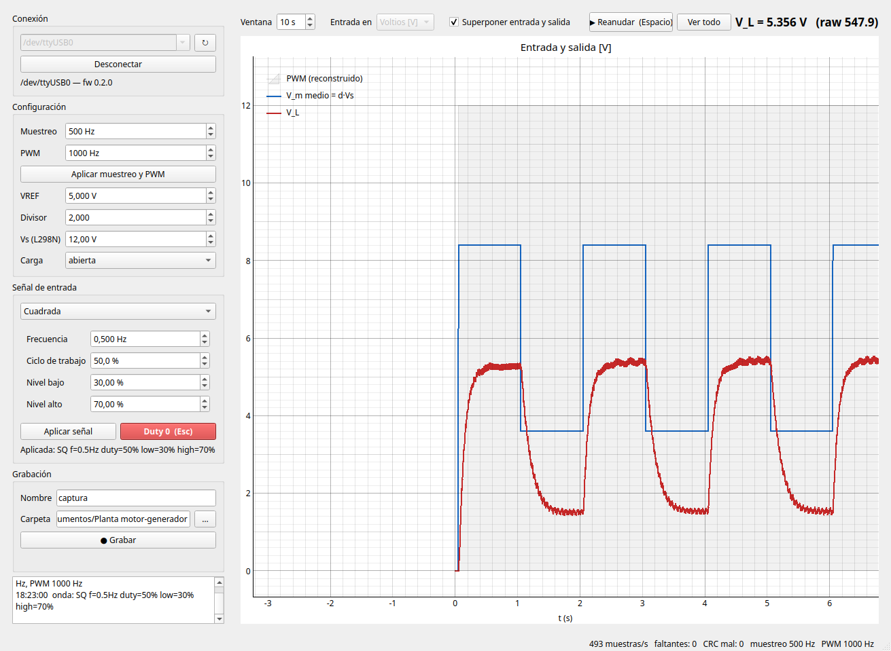

# Planta motor-generador DC: adquisición

Sistemas Dinámicos, ORT. Firmware para Arduino UNO y aplicación en Python
para **excitar la planta motor-generador con una entrada programable,
ver la salida en tiempo real y grabar ambas**.

- Entradas generadas en el Arduino: continua, cuadrada (frecuencia, ciclo
  de trabajo y niveles programables) y senoidal (frecuencia, offset y
  amplitud programables).
- Muestreo determinístico de 62 a 1000 Hz (500 Hz por defecto), con
  entrada y salida alineadas muestra a muestra.
- GUI en tiempo real, CLI para capturas reproducibles y ensayo automático
  de ganancia estática.
- Simulador de la planta para trabajar sin hardware.



## Contenido

```
firmware/        PlatformIO para Arduino UNO
host/            paquete Python "planta": GUI, CLI, simulador y tests
examples/        minimo.py: cliente de ~80 líneas que solo usa pyserial
docs/            PROTOCOLO.md: protocolo serie y funcionamiento del firmware
data/            capturas (ignoradas por git, salvo los ejemplo_*)
```

## 1. Hardware y conexionado

```
            +12 V                              Generador DC
              |                                 +---------+
        +-----------+      eje       +-------+  |         |---+--- V_L
 pin 9 -| ENA       |  OUT1/OUT2 --->| Motor |==|         |   |
  +5 V -| IN1       |                +-------+  +---------+  [SW1 560 Ω] [SW2 470 Ω]
   GND -| IN2  L298N|                                          |
        +-----------+                                         GND
                                     V_L --[10k]--+--[10k]-- GND
                                                  |
                                       A0 <-------+---[1 µF]--- GND
                                                  +---[Z 5V1]-- GND
```

| Señal | Conexión |
|---|---|
| PWM | **pin 9** (OC1A, Timer1) → ENA del L298N |
| Sentido | IN1 = 5 V e IN2 = GND fijos: **un solo sentido de giro**, V_L ≥ 0 siempre |
| Medición | V_L → divisor 10k/10k (÷2) → **A0**, con 1 µF y zener 5V1 a GND |
| Carga | SW1 = 560 Ω, SW2 = 470 Ω: abierta / 560 / 470 / 255 Ω (las dos en paralelo) |

El divisor más el capacitor forman un filtro RC de ≈ 32 Hz (τ ≈ 5 ms), y el
zener protege la entrada del ADC. Con duty 100 % y carga abierta, V_L ≈ 7,2–7,4 V,
o sea A0 ≈ 3,7 V: lejos del límite de 5 V.

> **Recomendado:** una resistencia de **10 kΩ entre ENA y GND**. Mientras el
> UNO arranca (1–2 s en cada reset, incluido el que hace la PC al abrir el
> puerto) el pin 9 queda flotando y el motor podría moverse.

## 2. Firmware

Hace falta [PlatformIO](https://platformio.org/install/cli). Si `pio` no
está en el PATH, usar `~/.platformio/penv/bin/pio`.

```bash
cd firmware
pio run                                   # compilar
pio run -t upload                         # subir (detecta el puerto)
pio run -t upload --upload-port /dev/ttyUSB0
pio device monitor                        # monitor serie a 250000 baud
```

Si la subida falla con `protocol error` o `not in sync`, casi siempre hay
otro programa con el puerto abierto: cerrar el monitor serie y la GUI.

**Prueba manual desde el monitor serie** (con el motor a la vista):

```
PING                 -> OK PONG planta-fw 0.2.0
DC 60                -> el motor gira
SQ 0.5 50 30 70      -> cuadrada de 2 s entre 30 y 70 %
SIN 0.5 60 25        -> senoidal entre 35 y 85 %
STATUS
STOP                 -> duty 0
```

No mandes `START` desde el monitor: el streaming es binario y se ve como basura.

Todos los comandos y el formato de las tramas están en
[`docs/PROTOCOLO.md`](docs/PROTOCOLO.md). Lo configurable en tiempo de
compilación está en `firmware/src/config.h` (`DUTY_MAX_PCT`, rate por
defecto, watchdog) y la frecuencia de PWM por defecto en `firmware/src/pwm.h`.

**Seguridad:** al arrancar y ante `STOP` el duty es 0. Durante el streaming,
si en 2 s no llega ninguna línea desde la PC (por ejemplo, porque se colgó
el programa), el firmware pone duty 0 solo. La app manda un keepalive cada 0,5 s.

## 3. Aplicación Python

Python 3.10 o superior.

```bash
cd host
python3 -m venv .venv
.venv/bin/pip install -e ".[dev]"        # Windows: .venv\Scripts\pip install -e ".[dev]"
```

Queda el comando `planta` en `host/.venv/bin/` (Windows: `host\.venv\Scripts\`).

**Permisos del puerto en Ubuntu:** el usuario tiene que estar en el grupo
`dialout`:

```bash
sudo usermod -aG dialout $USER     # y cerrar sesión para que tome efecto
```

El puerto es `/dev/ttyUSB0` con un clon CH340 o `/dev/ttyACM0` con un UNO
original. En Windows es `COMn`; en macOS, `/dev/cu.usbserial-*` o
`/dev/cu.usbmodem*` (en algunas versiones de macOS los clones CH340 piden el
driver del fabricante). `planta ports` lista los disponibles.

### GUI

```bash
planta gui
```

1. Elegir el puerto (o `sim://` para el simulador) y **Conectar**. El
   streaming arranca solo, con duty 0.
2. **Señal de entrada:** continua, cuadrada o senoidal, con sus parámetros, y
   **Aplicar señal**. Si los valores no son válidos (por ejemplo,
   offset − amplitud < 0) aparece el error y no se manda nada.
   **Duty 0** (o la tecla **Esc**) frena el motor sin cortar el gráfico.
3. **Gráficos:** entrada (en voltios por defecto, o en % de duty) y V_L, con
   una ventana deslizante de 1 a 120 s. En voltios, el PWM aparece en gris
   detrás del valor medio d·Vs. **Superponer entrada y salida** los junta en
   un solo gráfico.
4. **Pausar** (o la **barra espaciadora**): congela el gráfico para
   explorarlo con el mouse (arrastrar = desplazar, rueda = zoom, **Ver todo**
   = los últimos 120 s). La adquisición y la grabación siguen corriendo.
   Haciendo zoom de unos pocos milisegundos se ven los pulsos del PWM.
5. **Grabar → Detener y guardar:** genera
   `AAAAMMDD_HHMMSS_<nombre>.csv` en *Documentos/Planta motor-generador*
   (o la carpeta elegida, que se recuerda). Si se cambia la onda mientras
   se graba, el cambio queda registrado con su tiempo en la metadata.
6. Arriba a la derecha está **V_L** promediada en 0,5 s y su valor crudo del
   ADC: es lo que hay que mirar para calibrar (ver sección 6).

Mientras se graba quedan bloqueados el muestreo, el PWM y la carga, para que
la metadata no mienta. Al cerrar la ventana se guarda la grabación en curso y
el duty queda en 0.

### CLI: capturas reproducibles

```bash
planta capture --port /dev/ttyUSB0 --wave sin --f 1 --offset 50 --amp 30 --duration 10 --load abierta
planta capture --port /dev/ttyUSB0 --wave sq --f 0.5 --duty 50 --low 30 --high 70 --duration 8 --load 470
planta capture --port /dev/ttyUSB0 --wave dc --pct 60 --duration 5 --out data/escalon_60.csv
```

- Graba `--pre` segundos en duty 0 (0,5 por defecto) como línea de base,
  aplica la onda y graba `--duration` segundos desde que la onda arranca. El
  instante exacto en que arrancó queda en la metadata como `t_onda_s`.
- Otras opciones: `--rate` (500), `--pwmf` (1000), `--vref` (5.0), `--div`
  (2.0), `--vs` (12), `--load` (abierta/560/470/255). `planta capture -h`
  las lista todas.
- Sin `--out`, guarda en `data/AAAAMMDD_HHMMSS_<onda>.csv`.
- Siempre termina con duty 0, aunque haya un error o un Ctrl+C.

### CLI: ensayo de ganancia estática

```bash
planta static-gain --port /dev/ttyUSB0 --from 0 --to 100 --step 5 --settle 2 --avg 1 --down --load abierta
```

Para cada duty aplica una continua, espera `--settle` s a que se estabilice y
promedia los `--avg` s siguientes. Las ventanas se cuentan en muestras, no con
el reloj de la PC. Con `--down` vuelve a barrer de bajada para medir la
histéresis. Genera tres archivos:

- `..._ganancia.csv`: un renglón por escalón (`duty_pct`, `Vm_nom_V`,
  `VL_V`, `VL_std_V`, `ganancia_VL_Vm`, …). Un `VL_std_V` grande indica que
  ese punto no estaba en régimen (por ejemplo, el motor arrancó durante el
  promedio).
- `..._ganancia_crudo.csv`: la serie temporal completa del ensayo.
- `..._ganancia.png`: V_L vs V_m y V_L/V_m vs V_m, subiendo y bajando.

### Simulador

En cualquier lugar donde va un puerto se puede poner `sim://`: un Arduino
falso que habla el mismo protocolo, con una planta de primer orden con zona
muerta e histéresis ajustada a la planta real. Sirve para practicar, armar
el informe sin la planta o desarrollar.

```bash
planta capture --port sim:// --wave sq --f 0.5 --high 70 --low 30 --duration 6
```

### Tests

```bash
cd host && .venv/bin/pytest
```

Cubren el parser de tramas (incluido el flujo corrupto), el CRC, la
generación y validación de comandos, captura, CSV, ganancia estática, la
reconstrucción del PWM y la GUI (sin pantalla, contra el simulador).

## 4. Formato del CSV

Metadata en líneas de comentario (`#`) y después las columnas:

```
# planta motor-generador DC: captura
# fecha: 2026-10-18T17:49:14-03:00
# puerto: /dev/ttyUSB0
# firmware: 0.2.0
# host: planta 0.1.0
# rate_Hz: 500
# pwm_Hz: 1000
# pwm_steps: 16000
# VREF_V: 5
# divisor: 2
# Vs_V: 12
# carga_ohm: abierta
# onda: SIN f=1Hz offset=50% amp=30%
# t_onda_s: 0.516
# duracion_s: 10
# tramas_crc_mal: 0
# perdidas_firmware: 0
# muestras: 5252
# muestras_faltantes: 0
# VL_V = divisor * adc_raw * VREF_V / 1023
# Vm_nom_V = duty_pct/100 * Vs_V (nominal, sin la caida del L298N)
t_s,sample_idx,duty_pct,Vm_nom_V,adc_raw,VL_V
0.000000,0,0.0000,0.0000,0,0.0000
...
```

| Columna | Significado |
|---|---|
| `t_s` | tiempo desde la primera muestra grabada = (idx − idx₀) / rate |
| `sample_idx` | índice de muestra del firmware (un salto = muestras perdidas) |
| `duty_pct` | duty aplicado en esa muestra |
| `Vm_nom_V` | `duty_pct/100 · Vs`: tensión de motor **nominal** (ver limitaciones) |
| `adc_raw` | lectura cruda de A0 (0..1023) |
| `VL_V` | `divisor · adc_raw · VREF / 1023` |

Ejemplos reales en `data/ejemplo_sin_1Hz.csv` y
`data/ejemplo_ganancia_abierta.{csv,png}`.

Para leerlo:

```python
import pandas as pd
df = pd.read_csv("archivo.csv", comment="#")
```

En MATLAB: `readtable("archivo.csv", "CommentStyle", "#")`.

## 5. Mediciones de referencia (carga abierta)

**Zona muerta según la frecuencia del PWM.** Rampa de a 2 % desde el reposo,
1 s por escalón:

| PWM | Arranca en | Se detiene en |
|---|---|---|
| 250 Hz | ≤ 20 % | 14 % |
| 500 Hz | 28 % | 16 % |
| **1 kHz (por defecto)** | **48 %** | **22 %** |
| 2 kHz | 54 % | 30 % |
| 4 kHz | 66 % | 40 % |
| 8 kHz | 68 % | 52 % |
| 20 kHz | 62 % | 56 % |

Con PWM lento la corriente alcanza a subir en cada pulso y vence el
rozamiento estático; con PWM rápido la inductancia la promedia y el L298N
pierde más en cada conmutación. 1 kHz es el compromiso: zona muerta
razonable y el ripple 30 veces por encima del filtro de 32 Hz. 250 y 500 Hz
quedan descartados porque coinciden con el muestreo (aliasing sincrónico).
La frecuencia se cambia con `--pwmf` o desde la GUI.

**Ganancia estática** (`data/ejemplo_ganancia_abierta.png`, PWM 1 kHz,
pasos de 5 %): arranca en 40 %, se detiene en 20 %. La ganancia V_L/V_m es
máxima (≈ 0,69) alrededor de V_m = 6–7 V y baja a ≈ 0,57 cerca de 11 V.

## 6. Calibración

V_L no se mide directamente: se calcula como `divisor · adc · VREF / 1023`.
El divisor real depende de la tolerancia de las resistencias, VREF es el
riel de 5 V del USB (suele estar entre 4,8 y 5,1 V) y el zener 5V1 fuga un
poco a 3,7 V. Para calibrar todo junto:

1. En la GUI, aplicar una continua (por ejemplo, 80 %) y esperar el régimen.
2. Medir V_L con el tester en la salida del generador **al mismo tiempo**.
3. Ajustar **Divisor** hasta que la V_L de la GUI coincida con el tester
   (`divisor = V_tester · 1023 / (raw · VREF)`).
4. Usar ese valor en la GUI o con `--div` en la CLI: queda en la metadata.

## 7. Limitaciones a tener en cuenta

- **Filtro RC de 32 Hz en A0.** También filtra la señal: a 5 Hz atenúa 1 % y
  atrasa 9°; a 32 Hz, 3 dB y 45°. Para identificar la planta conviene
  quedarse muy por debajo, o incluir el polo del filtro en el modelo.
- **V_m nominal ≠ V_m real.** `Vm_nom_V = duty · 12 V` no descuenta la caída
  del L298N (bipolar, ~2 V) ni las pérdidas de conmutación. Se nota en el
  ensayo estático: de 95 a 100 % V_L salta 0,6 V, contra ~0,2 V de cualquier
  otro escalón de 5 %, porque a 100 % no hay conmutación.
- **Zona muerta con histéresis**, y el duty de arranque depende además de
  dónde quedó parado el rotor. Las mediciones de la sección 5 son de una
  corrida: conviene darlas como rango.
- **Asimetría:** con la cuadrada, V_L sube en ~0,2 s y baja en ~0,5 s o más.
  Al acelerar empuja el motor; al bajar el duty frenan solo el rozamiento y
  la carga.
- **Cuantización:** 10 bits, o sea ~9,8 mV de V_L por cuenta.
- **Latencia:** el ADC convierte ~104 µs después del tick y el duty nuevo se
  aplica al empezar el siguiente período de PWM (≤ 1 ms a 1 kHz). Ambos
  efectos son chicos frente a la dinámica de la planta.
- **El PWM gris de la GUI es una reconstrucción** hecha con el duty de cada
  muestra: sirve para visualizar, no es una medición.

## 8. Hacer tu propia versión

El Arduino queda cargado con un protocolo simple y documentado: cualquier
programa que abra el puerto serie lo puede usar, sin depender de esta app.

- [`docs/PROTOCOLO.md`](docs/PROTOCOLO.md): comandos, respuestas, formato
  de las tramas, CRC, watchdog y cómo funciona el firmware por dentro.
- [`examples/minimo.py`](examples/minimo.py): cliente completo de ~80
  líneas que solo necesita `pyserial`. Aplica una senoidal, graba 5 s y
  guarda un CSV. Buen punto de partida para portarlo a MATLAB, LabVIEW u
  otro lenguaje.

```bash
pip install pyserial
python examples/minimo.py /dev/ttyUSB0
```
